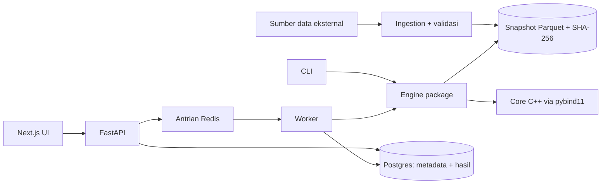

# PRD: Quant Research & Backtesting Platform

**Versi:** 0.1 (draft) · **Tanggal:** 12 Oktober 2026 · **Pemilik:** Dio Stania Adinata

---

## 1. Ringkasan

Quant Research & Backtesting Platform adalah sistem untuk menguji strategi investasi pada data historis secara benar, konsisten, dan dapat direproduksi. Fokus proyek ini adalah research infrastructure, bukan prediksi harga.

Proyek ini dirancang sebagai portofolio untuk dua audiens:

- **Quant developer:** menunjukkan kebenaran simulator, pemahaman bias backtest, dan kode berperforma tinggi (C++).
- **Backend/fintech engineer:** menunjukkan desain API, idempotency, integritas data, audit trail, dan kesiapan operasional.

Prioritas utamanya adalah quant developer. Lapisan backend dibangun di atas engine, bukan sebaliknya.

## 2. Latar belakang dan masalah

Hasil backtest mudah terlihat bagus padahal salah. Penyebab yang paling umum:

| Masalah | Akibat |
| --- | --- |
| Look-ahead bias | Strategi "tahu" harga yang belum tersedia saat keputusan diambil |
| Survivorship bias | Universe aset hanya berisi yang bertahan sampai hari ini |
| Overfitting dari parameter sweep | Parameter terbaik dipilih dari banyak percobaan, Sharpe menipu |
| Biaya transaksi diabaikan | Strategi dengan turnover tinggi tampak menguntungkan |
| Data atau konfigurasi berubah diam-diam | Hasil lama tidak bisa direproduksi |
| Asumsi risk-free rate tidak sesuai mata uang | Sharpe tidak sebanding antar eksperimen |

Platform ini harus mencegah, mendeteksi, atau setidaknya mendokumentasikan setiap masalah di atas.

## 3. Tujuan dan non-tujuan

### Tujuan

- **G1.** Menjalankan backtest yang bebas look-ahead bias, dibuktikan lewat automated test.
- **G2.** Setiap run dapat direproduksi bit-per-bit dari konfigurasi, versi data, dan versi engine.
- **G3.** Membandingkan strategi dengan benchmark menggunakan asumsi biaya dan periode yang sama.
- **G4.** Menyediakan API yang idempotent dan rekam jejak run yang immutable.
- **G5.** Menyediakan core simulator C++ yang hasilnya identik dengan versi Python dan lebih cepat secara terukur.

### Non-tujuan

- Live trading, paper trading, atau koneksi ke broker.
- Prediksi harga atau model machine learning.
- Rekomendasi investasi dalam bentuk apa pun.
- Sistem multi-user dengan autentikasi di versi awal.
- Leverage, short selling, dan derivatif di versi awal.
- Data intraday. Versi awal hanya data harian.

## 4. Pengguna

| Persona | Kebutuhan utama |
| --- | --- |
| Researcher (pemilik proyek) | Menguji hipotesis dengan cepat, membandingkan run, yakin hasilnya benar |
| Reviewer teknis (rekruter, interviewer) | Clone repo, jalankan satu perintah, dapat hasil yang sama dengan README |
| Kontributor masa depan | Menambah strategi baru tanpa menyentuh simulator |

## 5. Ruang lingkup per fase

| Fase | Isi | Audiens utama | Kriteria selesai |
| --- | --- | --- | --- |
| 1. Engine + test suite | Data loader, strategi, simulator vectorized dan event-driven, metrik, validasi | Quant | Seluruh test invarian lulus, CLI bisa menjalankan dan membandingkan run |
| 2. Lapisan backend | FastAPI, Postgres, worker, idempotency, run immutable, Docker Compose, CI | Fintech | `docker compose up` lalu run via API menghasilkan metrik identik dengan CLI |
| 3. Core C++ | Simulator event-driven dalam C++ via pybind11 | Quant | Parity test lulus, benchmark terdokumentasi |
| 4. UI minimal | Next.js: equity curve, drawdown, perbandingan run, riwayat run | Keduanya | Run bisa dibuat dan dibandingkan dari browser |

Fase 4 hanya dikerjakan setelah fase 1 sampai 3 solid.

## 6. Kebutuhan fungsional

Prioritas: **M** = Must, **S** = Should, **C** = Could.

### 6.1 Data pasar

| ID | Kebutuhan | Prioritas | Fase |
| --- | --- | --- | --- |
| FR-D1 | Mengambil harga harian (OHLCV + adjusted close) dari sumber eksternal, awalnya yfinance | M | 1 |
| FR-D2 | Menyimpan setiap pengambilan data sebagai snapshot Parquet yang tidak pernah ditimpa | M | 1 |
| FR-D3 | Menghitung SHA-256 untuk setiap snapshot dan memakainya sebagai identitas dataset | M | 1 |
| FR-D4 | Validasi data: nilai kosong, tanggal duplikat, tanggal tidak urut, harga ≤ 0, lonjakan harga ekstrem | M | 1 |
| FR-D5 | Laporan validasi disimpan bersama snapshot; dataset yang gagal validasi tidak bisa dipakai run | M | 1 |
| FR-D6 | Mendukung universe aset dengan keanggotaan per tanggal (point-in-time) untuk mengurangi survivorship bias | S | 2 |
| FR-D7 | Menyimpan seri risk-free rate per mata uang (misalnya yield SBN untuk IDR, T-bill untuk USD) | S | 1 |

### 6.2 Konfigurasi eksperimen

| ID | Kebutuhan | Prioritas | Fase |
| --- | --- | --- | --- |
| FR-C1 | Konfigurasi didefinisikan sebagai model Pydantic yang tervalidasi | M | 1 |
| FR-C2 | Field wajib: aset, rentang tanggal, strategi + versi, parameter, modal awal, benchmark, biaya transaksi (bps), slippage (bps), risk-free rate, timing eksekusi | M | 1 |
| FR-C3 | Timing eksekusi eksplisit: sinyal dihitung di close hari t, dieksekusi di close t+1 (default) atau open t+1 | M | 1 |
| FR-C4 | Konvensi annualisasi eksplisit (default 252 hari perdagangan) | M | 1 |
| FR-C5 | Konfigurasi bisa ditulis sebagai file YAML untuk CLI | S | 1 |

### 6.3 Strategi

| ID | Kebutuhan | Prioritas | Fase |
| --- | --- | --- | --- |
| FR-S1 | Interface strategi yang hanya menerima data sampai tanggal t | M | 1 |
| FR-S2 | Buy-and-hold | M | 1 |
| FR-S3 | Time-series momentum (satu aset, lookback dapat dikonfigurasi) | M | 1 |
| FR-S4 | Mean reversion sederhana (misalnya z-score terhadap rata-rata bergerak) | M | 1 |
| FR-S5 | Cross-sectional momentum (ranking banyak aset) | S | 2 |
| FR-S6 | Setiap strategi punya nama dan versi; perubahan logika menaikkan versi | M | 1 |

### 6.4 Simulator

| ID | Kebutuhan | Prioritas | Fase |
| --- | --- | --- | --- |
| FR-B1 | Simulator vectorized untuk strategi tanpa ketergantungan path | M | 1 |
| FR-B2 | Simulator event-driven (loop per bar) | M | 1 |
| FR-B3 | Biaya transaksi dan slippage dikenakan setiap kali posisi berubah | M | 1 |
| FR-B4 | Output: equity curve harian, daftar transaksi, posisi harian, kas | M | 1 |
| FR-B5 | Long-only, tanpa leverage di versi awal; pelanggaran batas menghasilkan error, bukan diam-diam dipotong | M | 1 |

### 6.5 Metrik performa dan risiko

| ID | Kebutuhan | Prioritas | Fase |
| --- | --- | --- | --- |
| FR-M1 | CAGR, volatilitas tahunan, Sharpe ratio (dengan risk-free rate eksplisit), Sortino ratio | M | 1 |
| FR-M2 | Maximum drawdown dan durasi drawdown terpanjang | M | 1 |
| FR-M3 | Turnover dan total biaya transaksi | M | 1 |
| FR-M4 | Excess return dan tracking error terhadap benchmark | S | 1 |
| FR-M5 | Setiap metrik menyimpan rumus dan konvensi yang dipakai di dokumentasi | M | 1 |

### 6.6 Validasi riset

| ID | Kebutuhan | Prioritas | Fase |
| --- | --- | --- | --- |
| FR-V1 | Split in-sample dan out-of-sample yang ditetapkan sebelum eksperimen | M | 1 |
| FR-V2 | Walk-forward evaluation | S | 1 |
| FR-V3 | Parameter sweep yang mencatat jumlah total percobaan per studi | S | 1 |
| FR-V4 | Menampilkan peringatan overfitting bila parameter terbaik dipilih dari banyak percobaan | C | 2 |

### 6.7 Reproducibility dan audit trail

| ID | Kebutuhan | Prioritas | Fase |
| --- | --- | --- | --- |
| FR-R1 | `run_id` = hash dari konfigurasi ternormalisasi + hash dataset + versi engine | M | 1 |
| FR-R2 | Snapshot konfigurasi lengkap disimpan bersama run | M | 1 |
| FR-R3 | Run yang sudah selesai immutable; perubahan apa pun menghasilkan run baru | M | 2 |
| FR-R4 | Menjalankan ulang run dengan input yang sama menghasilkan metrik identik | M | 1 |

### 6.8 API

| ID | Kebutuhan | Prioritas | Fase |
| --- | --- | --- | --- |
| FR-A1 | API tidak berisi logika finansial; hanya validasi, orkestrasi, dan pembacaan hasil | M | 2 |
| FR-A2 | `POST /backtests` idempotent berdasarkan `run_id` (lihat bagian 10) | M | 2 |
| FR-A3 | Pagination untuk daftar run dan data equity curve yang panjang | S | 2 |
| FR-A4 | Error response konsisten dengan kode error yang terdokumentasi | M | 2 |

### 6.9 Job processing

| ID | Kebutuhan | Prioritas | Fase |
| --- | --- | --- | --- |
| FR-J1 | Backtest berjalan di worker terpisah lewat antrian (RQ atau arq dengan Redis) | M | 2 |
| FR-J2 | Status run: `queued`, `running`, `succeeded`, `failed` | M | 2 |
| FR-J3 | Retry otomatis untuk kegagalan infrastruktur (maksimal 3, exponential backoff); kegagalan validasi tidak di-retry | S | 2 |
| FR-J4 | Deteksi job yang mati lewat heartbeat timeout, lalu status menjadi `failed` dengan alasan tercatat | S | 2 |

### 6.10 Core C++

| ID | Kebutuhan | Prioritas | Fase |
| --- | --- | --- | --- |
| FR-X1 | Simulator event-driven dalam C++ dengan binding pybind11 dan interface yang sama dengan versi Python | M | 3 |
| FR-X2 | Parity test: hasil C++ identik dengan Python dalam toleransi numerik yang terdokumentasi | M | 3 |
| FR-X3 | Benchmark reproducible yang membandingkan Python vectorized, Python event-driven, dan C++ | M | 3 |
| FR-X4 | Engine dapat dipilih lewat konfigurasi; `engine_version` mencatat implementasi yang dipakai | S | 3 |

### 6.11 UI

| ID | Kebutuhan | Prioritas | Fase |
| --- | --- | --- | --- |
| FR-U1 | Grafik equity curve strategi vs benchmark | M | 4 |
| FR-U2 | Grafik drawdown | M | 4 |
| FR-U3 | Tabel perbandingan metrik antar run | M | 4 |
| FR-U4 | Riwayat run dengan status dan konfigurasi | S | 4 |
| FR-U5 | Form pembuatan run baru | C | 4 |

## 7. Kebutuhan non-fungsional

| Kategori | Kebutuhan |
| --- | --- |
| Kebenaran | Seluruh test invarian di bagian 11 wajib lulus di CI sebelum merge |
| Reproducibility | Run yang sama di mesin berbeda menghasilkan metrik identik |
| Performa | Target awal: satu aset, 10 tahun data harian selesai < 2 detik di Python event-driven; core C++ minimal 10× lebih cepat. Target direvisi setelah baseline diukur |
| Test coverage | Target awal ≥ 85% untuk package engine |
| Portabilitas | Seluruh sistem berjalan dengan `docker compose up` |
| Observability | Structured logging (JSON) dengan `run_id` di setiap baris log yang terkait run |
| Keamanan | Tidak ada secret di repository; konfigurasi lewat environment variable |
| Dokumentasi | README berisi cara menjalankan, asumsi, keterbatasan, dan contoh hasil nyata |

## 8. Arsitektur



Prinsip utama: engine adalah package Python mandiri yang bisa di-install. CLI, worker, dan test semuanya memanggil engine yang sama. API tidak pernah menghitung apa pun sendiri.

Struktur repository yang diusulkan (nama package masih nama kerja):

```
qrbt/
├── engine/            # package Python inti
│   ├── data/          # ingestion, validasi, snapshot
│   ├── strategies/    # interface + implementasi strategi
│   ├── sim/           # vectorized + event-driven
│   ├── metrics/       # metrik performa dan risiko
│   └── validation/    # OOS split, walk-forward, sweep
├── cpp/               # core C++ + binding pybind11
├── api/               # FastAPI
├── worker/            # consumer antrian
├── web/               # Next.js
├── tests/             # unit, property-based, parity
└── docs/              # PRD, keputusan desain, hasil riset
```

## 9. Model data

Harga historis disimpan di Parquet. Postgres menyimpan metadata dan hasil.

| Tabel | Isi utama | Catatan |
| --- | --- | --- |
| `datasets` | id, sumber, SHA-256, rentang tanggal, laporan validasi, waktu dibuat | Satu baris per snapshot |
| `assets` | ticker, nama, jenis instrumen, mata uang | |
| `strategies` | nama, versi, deskripsi parameter | Unique (nama, versi) |
| `backtest_runs` | run_id, snapshot konfigurasi (JSONB), dataset_id, engine_version, git commit, status, timestamp | Immutable setelah `succeeded` |
| `performance_metrics` | run_id, nama metrik, nilai, konvensi | |
| `equity_curves` | run_id, tanggal, nilai portofolio, nilai benchmark | Index (run_id, tanggal) |
| `trades` | run_id, tanggal, aset, arah, kuantitas, harga, biaya | |

## 10. Kontrak API

Base path: `/api/v1`

| Method | Endpoint | Fungsi |
| --- | --- | --- |
| POST | `/backtests` | Membuat run. Bila `run_id` sudah ada, mengembalikan `200` dengan run yang ada. Bila baru, mengembalikan `202 Accepted` dan memasukkan job ke antrian |
| GET | `/backtests` | Daftar run dengan filter strategi, status, dan pagination |
| GET | `/backtests/{run_id}` | Status, konfigurasi, dan metadata run |
| GET | `/backtests/{run_id}/metrics` | Metrik performa dan risiko |
| GET | `/backtests/{run_id}/equity-curve` | Equity curve dengan pagination |
| GET | `/backtests/{run_id}/trades` | Daftar transaksi |
| GET | `/strategies` | Daftar strategi beserta versi dan skema parameter |
| GET | `/datasets` | Daftar snapshot data beserta hash dan status validasi |

Idempotency berasal dari isi request itu sendiri (hash konfigurasi + data + engine), sehingga klien tidak perlu mengirim idempotency key terpisah.

## 11. Strategi pengujian

Test ditulis dengan pytest. Invarian diuji dengan Hypothesis (property-based testing).

| Test | Yang dibuktikan |
| --- | --- |
| Look-ahead | Mengacak semua harga setelah tanggal t tidak mengubah posisi sampai tanggal t |
| Buy-and-hold tanpa biaya | Return total sama persis dengan rasio harga akhir/awal |
| Monotonisitas biaya | Menaikkan biaya transaksi tidak pernah menaikkan return |
| Differential test | Simulator vectorized dan event-driven menghasilkan equity curve identik untuk strategi yang sama |
| Parity C++ | Core C++ identik dengan Python dalam toleransi terdokumentasi |
| Validasi silang metrik | Metrik sesuai dengan quantstats pada konvensi yang sama; perbedaan dijelaskan |
| Reproducibility | Menjalankan ulang run menghasilkan `run_id` dan metrik identik |
| Idempotency API | Dua POST identik menghasilkan satu run, bukan dua |
| Validasi data | Dataset dengan duplikat, tanggal tidak urut, atau harga ≤ 0 ditolak |

Library backtesting yang sudah ada (backtesting.py, vectorbt) dipakai hanya sebagai pembanding hasil, bukan sebagai engine.

## 12. Milestone

| Milestone | Isi | Kriteria keluar |
| --- | --- | --- |
| M1 | Data loader, snapshot, validasi, buy-and-hold, simulator vectorized | Test buy-and-hold dan validasi data lulus |
| M2 | Momentum, mean reversion, simulator event-driven, metrik, biaya | Test look-ahead, monotonisitas, dan differential lulus |
| M3 | OOS split, walk-forward, CLI, laporan run | Satu studi lengkap terdokumentasi di `docs/` |
| M4 | FastAPI, Postgres, worker, Docker Compose, CI | Test idempotency lulus; hasil API identik dengan CLI |
| M5 | Core C++ + benchmark | Parity test lulus; hasil benchmark di README |
| M6 | UI minimal | Run bisa dibandingkan dari browser |

Jadwal tidak ditetapkan di PRD ini karena bergantung pada beban kegiatan lain. Urutan milestone bersifat wajib, tenggatnya fleksibel.

## 13. Kriteria keberhasilan

- Reviewer bisa clone repo, menjalankan satu perintah, dan mendapatkan `run_id` serta metrik yang sama dengan README.
- README memuat minimal satu studi yang strateginya **gagal** atau hasilnya memburuk setelah biaya dan out-of-sample, beserta analisis penyebabnya.
- Setiap klaim kebenaran di README (bebas look-ahead, reproducible, idempotent) punya test yang bisa ditunjuk.
- Benchmark C++ vs Python dapat direproduksi oleh orang lain.

## 14. Risiko dan mitigasi

| Risiko | Dampak | Mitigasi |
| --- | --- | --- |
| yfinance berubah atau berhenti berfungsi | Ingestion gagal | Semua run memakai snapshot lokal; sumber data di belakang interface yang bisa diganti |
| Overscope (terutama UI) | Engine setengah matang | Fase 4 dikunci sampai fase 1 sampai 3 selesai |
| Kurva belajar C++ | Fase 3 molor | Versi Python menjadi oracle; fase 3 bisa dimulai dengan subset fitur simulator |
| Waktu terbatas karena kegiatan lain | Proyek terhenti di tengah | Setiap milestone menghasilkan sesuatu yang bisa didemonstrasikan sendiri |
| Data IDX tanpa keanggotaan indeks historis | Survivorship bias pada cross-sectional momentum | Dokumentasikan keterbatasan; mulai dari strategi satu aset |

## 15. Pertanyaan terbuka

- Sumber data apa yang dipakai untuk keanggotaan universe IDX secara point-in-time?
- Sumber seri risk-free rate IDR: yield SBN tenor berapa, dan dari mana datanya?
- Aset awal: ETF indeks Indonesia, ETF indeks AS, atau keduanya?
- C++ atau Rust untuk fase 3? Draft ini memilih C++ karena lebih umum di lowongan quant developer.
- Nama final proyek dan package.

## 16. Disclaimer

Platform ini adalah alat riset dan proyek portofolio. Hasil backtest bukan jaminan performa masa depan dan bukan rekomendasi investasi.
